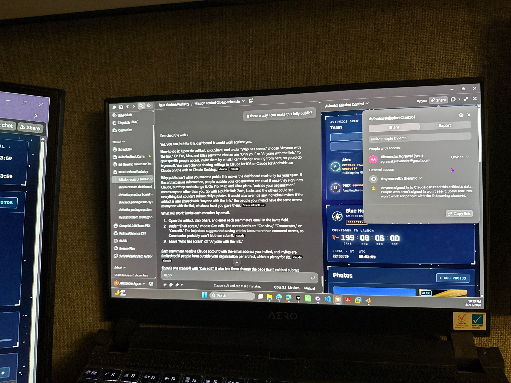
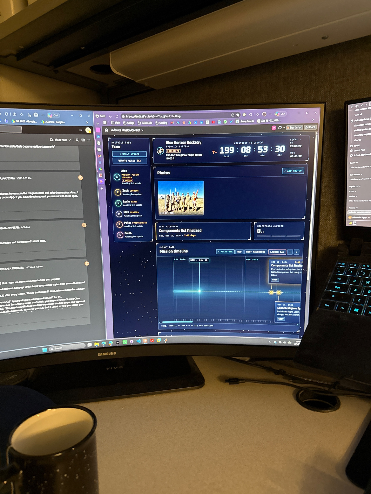

# Alex: Daily Updates

**Subsystem:** Primary flight computer

Add a new entry under **Log** each day you work on avionics, newest first. See the [Team Updates README](../README.md) for what each field means.

## Template

Copy this block, paste it under **Log**, and fill it in:

```markdown
## YYYY-MM-DD

**Worked on:** -\
**Completed:** -\
**Next:** -\
**Blockers:** -\
**Parts:**
- part name | subsystem | qty | status
```

## Log

<!-- Newest entry goes directly below this line. -->

## 2026-11-13

**Worked on:** - Tested Mission update with Kaleb Abeye\
**Completed:** -\
**Next:** -\
**Blockers:** -\
**Helped:** -\
**Helped by:** -\
**Collaboration notes:** -\
**Photos:**\
\
**Parts:**
- none

## 2026-11-12

**Worked on:** Added schedules to Mission Control Dashboard\
**Completed:** -\
**Next:** Need to make sure it works for other members\
**Blockers:** -\
**Helped:** -\
**Helped by:** -\
**Collaboration notes:** -\
**Photos:**\
\
**Parts:**
- none

## 2026-11-12

**Worked on:** Added Mission Control website with Claude\
**Completed:** -\
**Next:** Add scheduling to it\
**Blockers:** -\
**Helped:** -\
**Helped by:** -\
**Collaboration notes:** -\
**Photos:**\
\
**Parts:**
- none

## 2026-11-12

**Worked on:** I read some articles about how rocketry teams are run in other universities.\
**Completed:** Read an article about how rocketry teams are run by a university in Austrialia. Attended team meeting and discussed drag with Jacob.\
**Next:** Need to read more of Nasa Engineering Handbook\
**Blockers:** NA\
**Helped:** -\
**Helped by:** -\
**Collaboration notes:** Jacob Peay\
**Parts:**
- none
