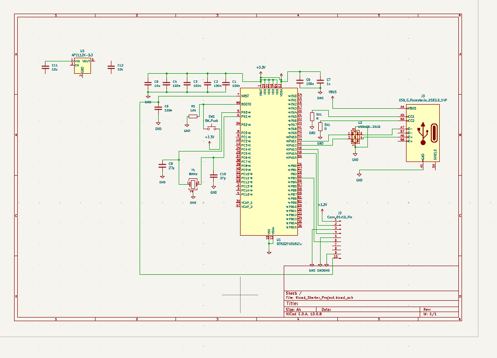

# Lucie: Daily Updates

**Subsystem:** Radio

Add a new entry under **Log** each day you work on avionics, newest first. See the [Team Updates README](../README.md) for what each field means.

## Template

Copy this block, paste it under **Log**, and fill it in:

```markdown
## YYYY-MM-DD

**Worked on:** -\
**Completed:** -\
**Next:** -\
**Blockers:** -\
**Parts:**
- part name | subsystem | qty | status
```

## Log

<!-- Newest entry goes directly below this line. -->

## 2026-11-16

**Worked on:** I worked on the starter board, primarily on wiring the USB receptacle, headers, and USB ESD Protection.\
**Completed:** USB system was wired\
**Next:** Work towards adding in the regulator\
**Blockers:** -\
**Helped:** -\
**Helped by:** Alex\
**Collaboration notes:** Alex gave feedback on the USB Receptacle I had in my Kicad drawing which I switched to a smaller receptacle\
**Photos:**\
\
**Parts:**
- none
