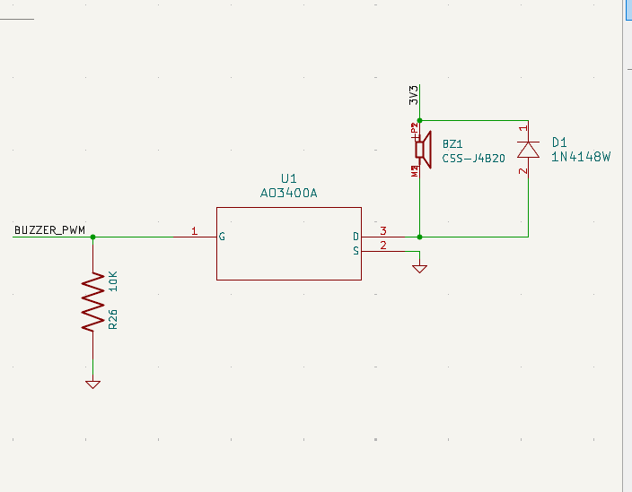
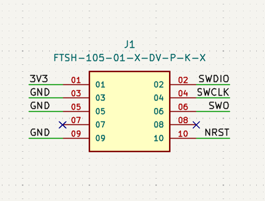

# Peter: Daily Updates

**Subsystem:** Pyrotechnics

Add a new entry under **Log** each day you work on avionics, newest first. See the [Team Updates README](../README.md) for what each field means.

## Template

Copy this block, paste it under **Log**, and fill it in:

```markdown
## YYYY-MM-DD

**Worked on:** -\
**Completed:** -\
**Next:** -\
**Blockers:** -\
**Parts:**
- part name | subsystem | qty | status
```

## Log

<!-- Newest entry goes directly below this line. -->

## 2026-11-17

**Worked on:** L1 STM32 Board\
**Completed:** - Debug & Programming; - Buzzer System\
**Next:** Pyro + Updating Footprints\
**Blockers:** -\
**Helped:** -\
**Helped by:** -\
**Collaboration notes:** -\
**Photos:**\
\
\
**Parts:**
- none
