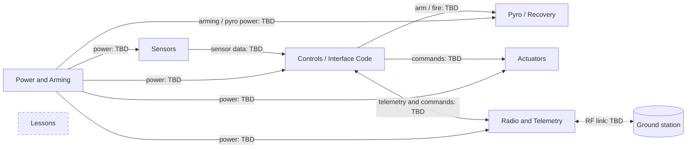

# Avionics Subsystems

Each avionics subsystem has its own folder with a `requirements.md` file. Together they are the single source of truth for what each subsystem must do and how the subsystems connect.

| Subsystem | Owner(s) | Status | Requirements |
|---|---|---|---|
| Power and Arming | TBD | Draft | [power-arming/requirements.md](power-arming/requirements.md) |
| Pyro / Recovery | Peter | Draft | [pyro-recovery/requirements.md](pyro-recovery/requirements.md) |
| Controls / Interface Code | TBD | Draft | [controls-interface-code/requirements.md](controls-interface-code/requirements.md) |
| Sensors | Max | Draft | [sensors/requirements.md](sensors/requirements.md) |
| Radio and Telemetry | Lucie | Draft | [radio-telemetry/requirements.md](radio-telemetry/requirements.md) |
| Lessons | Zach | Draft | [lessons/requirements.md](lessons/requirements.md) |
| Actuators | TBD | Draft | [actuators/requirements.md](actuators/requirements.md) |

Status is one of **Draft**, **In review**, or **Agreed**. Update this table when your file's status changes.

## How the subsystems connect

Draft only. The connections below are placeholders until each interface is written up in the requirements files.

Lessons is training material, not flight hardware, so it has no flight interfaces.

## Conventions

- **One folder per subsystem**, named after the subsystem, not a person. Owners are listed in the file header and in the table above, so they're easy to update when people change roles.
- **Every requirements file uses the same headings in the same order.** Start from [_template.md](_template.md).
- **Keep `requirements.md` to conclusions.** Put long research, datasheets, comparisons, and test results in a `notes/` folder inside your subsystem folder, and link to them.
- **Each interface is written up once**, by the subsystem that owns it. The other side links to it instead of copying it.
- **Link, don't repeat.** When you mention another subsystem, link to its file with a relative link, for example `../sensors/requirements.md`.
- **Unknowns are fine.** Write "TBD" and add a matching question to your Questions list.
- **New acronyms go in [glossary.md](glossary.md).**

## Making changes

1. Edit your subsystem's `requirements.md` (the GitHub web editor works fine).
2. Update the **Last updated** date in the file header.
3. Commit with a message like `Requirements: sensors scope and questions`.
4. If you change an interface, tell the owner of the other subsystem.
